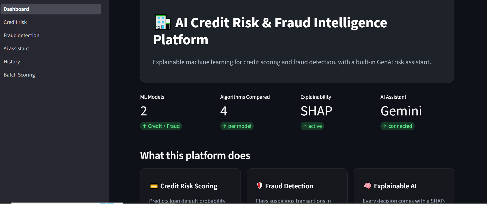
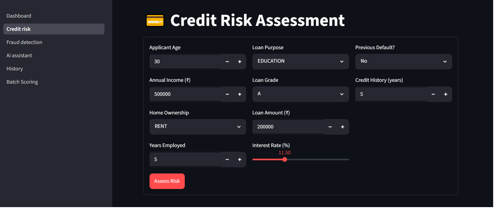
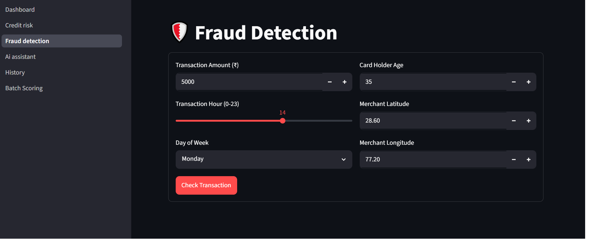
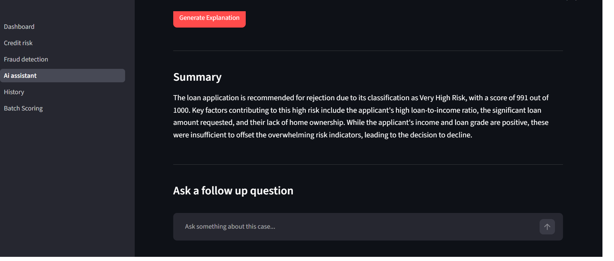
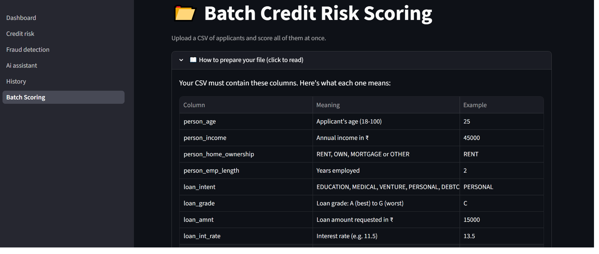
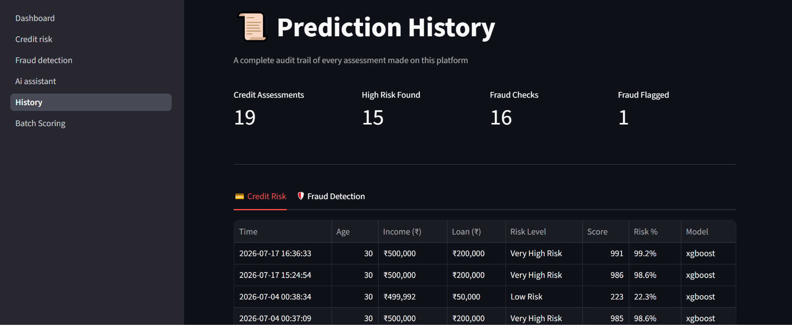

<div align="center">

# 🏦 AI Credit Risk & Fraud Intelligence Platform

### Explainable machine learning for credit scoring and fraud detection — with a built-in GenAI risk assistant

[](https://www.python.org/)
[](https://streamlit.io/)
[](https://xgboost.readthedocs.io/)
[](https://shap.readthedocs.io/)
[](https://ai.google.dev/)

[](.)
[](LICENSE)
[](.)

### 🔗 [**View Live Demo →**](https://creditriskfrauddetection.streamlit.app)

</div>

---

## 📖 Overview

An **end-to-end machine learning platform** that predicts loan default risk and detects fraudulent transactions in real time. Every prediction is **fully explainable** through SHAP and translated into plain English by a **Gemini-powered assistant** — because in finance, no decision should be a black box.

Built as a production-style fintech system, it combines classical ML, model explainability, generative AI, batch processing, and data persistence into a single, deployable application.

> **Why this matters:** Banks face two costly problems — rejecting good customers (lost business) and approving high-risk customers (financial loss). This platform automates that decision with a rigorously engineered, explainable, and auditable ML system.

---

## ✨ Key Features

| Feature | Description |
|---------|-------------|
| 💳 **Credit Risk Scoring** | Predicts loan default probability with a tuned XGBoost model — returns a 0–1000 risk score and a clear approve/reject recommendation |
| 🛡️ **Fraud Detection** | Flags suspicious transactions from amount, timing, location, and cardholder behaviour using a Gradient Boosting model |
| 🧠 **Explainable AI (SHAP)** | Every prediction shows exactly which factors drove it — essential for regulatory compliance |
| 🤖 **GenAI Risk Assistant** | A Gemini-powered assistant that explains predictions in plain English and answers follow-up questions |
| 📂 **Batch Scoring** | Upload a CSV of hundreds of applicants and score them all at once with **vectorized inference** and downloadable results |
| 📜 **Audit Trail** | Every prediction is logged to a database with full history and CSV export — built for compliance |

---

## 🖥️ Demo

### Dashboard


### Credit Risk Assessment


### Fraud Detection


### AI Risk Assistant


### Batch Scoring


### Prediction History


---

## 🧪 Machine Learning Approach

This project prioritises **rigorous, production-grade ML engineering** over quick results:

- **🔒 Leakage-free pipelines** — All preprocessing (imputation, scaling, SMOTE) runs *inside* `imblearn` Pipelines, so each step fits only on the training fold during cross-validation. This eliminates the data leakage that silently inflates most beginner models' scores.
- **⚖️ Class imbalance handling** — SMOTE addresses severe imbalance (22% default rate for credit, 0.6% fraud rate) by synthesising minority-class examples — applied only to training data.
- **🔍 Model comparison** — Four algorithms (Random Forest, XGBoost, Gradient Boosting, Logistic Regression) are trained and compared for each task, with the winner selected **automatically by cross-validation ROC AUC**.
- **🎛️ Hyperparameter tuning** — `RandomizedSearchCV` searches each model's parameter space for optimal settings.
- **📏 Honest evaluation** — Models are selected by cross-validation; the held-out test set is touched **only once** for a final unbiased score. ROC AUC is used over accuracy because it isn't fooled by class imbalance.

### 📊 Results

| Model | Task | CV ROC AUC | Test ROC AUC |
|-------|------|:----------:|:------------:|
| **XGBoost** | Credit Risk | 0.945 | **0.951** |
| **Gradient Boosting** | Fraud Detection | 0.975 | **0.977** |

> The close agreement between cross-validation and test scores confirms the models are **stable and not overfitting** — and the scores are honest, with no leakage.

---

## 🛠️ Tech Stack

<div align="center">

| Layer | Technologies |
|:-----:|:------------:|
| **Machine Learning** | scikit-learn · XGBoost · imbalanced-learn (SMOTE) |
| **Explainability** | SHAP |
| **Generative AI** | Google Gemini |
| **Frontend** | Streamlit · Plotly |
| **Database** | SQLite |
| **Deployment** | Streamlit Community Cloud |

</div>

---

## 📁 Project Structure

```
credit_risk_platform/
├── app/
│   ├── Dashboard.py              # Landing page
│   └── pages/
│       ├── 1_Credit_Risk.py      # Credit scoring + SHAP
│       ├── 2_Fraud_Detection.py  # Fraud detection + SHAP
│       ├── 3_AI_Assistant.py     # Gemini-powered chat
│       ├── 4_History.py          # Prediction audit trail
│       └── 5_Batch_Scoring.py    # Bulk CSV scoring
├── src/
│   ├── utils.py                  # Data loading & preprocessing
│   ├── credit_model.py           # Credit pipeline, training, inference
│   ├── fraud_model.py            # Fraud pipeline, training, inference
│   ├── explainability.py         # SHAP integration
│   ├── genai_assistant.py        # Gemini integration
│   └── database.py               # Prediction logging
├── data/                         # Datasets
├── models/                       # Trained model pipelines
├── config.py
└── requirements.txt
```

---

## 🚀 Getting Started

```bash
# 1. Clone the repository
git clone https://github.com/siddhiinarangg/credit_risk_platform.git
cd credit_risk_platform

# 2. Create and activate a virtual environment
python -m venv venv
venv\Scripts\activate          # Windows
# source venv/bin/activate     # macOS / Linux

# 3. Install dependencies
pip install -r requirements.txt

# 4. Add your Gemini API key
echo GEMINI_API_KEY=your_key_here > .env

# 5. Train the models (first run only)
python src/credit_model.py
python src/fraud_model.py

# 6. Launch the app
streamlit run app/Dashboard.py
```

The app will open at `http://localhost:8501`.

---

## 💡 Key ML Concepts Demonstrated

- **Data leakage prevention** via scikit-learn / imblearn pipelines
- **Class imbalance** handling with SMOTE
- **ROC AUC over accuracy** for imbalanced classification
- **Precision–recall trade-offs** — recall prioritised to catch defaults and fraud (minimising costly false negatives)
- **Model explainability** with SHAP for regulatory transparency
- **Vectorized batch inference** for efficient bulk scoring
- **Automated model selection** across multiple algorithms

---

## 🔮 Future Enhancements

- [ ] FastAPI backend to serve models via REST endpoints
- [ ] Docker containerisation for reproducible deployment
- [ ] Decision-threshold tuning based on business cost of errors
- [ ] Model monitoring for data drift detection
- [ ] Replace the Gemini API with a privately fine-tuned LLM

---

## 👤 Author

**Siddhi Narang**

Built as a portfolio project demonstrating end-to-end machine learning engineering — from leakage-free preprocessing and rigorous evaluation to an explainable, deployed, GenAI-integrated application.

---

<div align="center">

⭐ **If you found this project interesting, consider giving it a star!** ⭐

</div>
